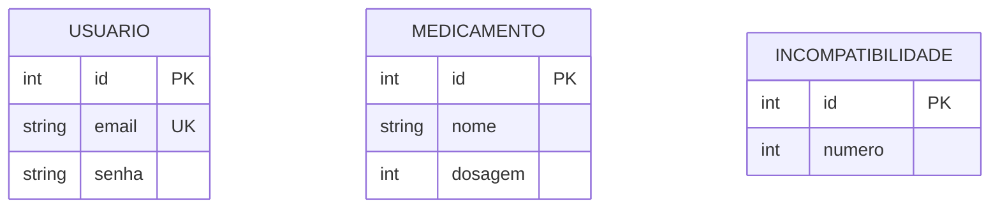

# MediCheck

Aplicação web para **consultar a compatibilidade entre medicamentos**. O usuário cadastra medicamentos, registra combinações que são incompatíveis e depois testa se uma combinação de medicamentos tem alguma incompatibilidade registrada.

> ⚠️ O MediCheck é um apoio informativo e não substitui a orientação de um profissional de saúde.


## 1. Descrição do problema e da solução

**Problema.** Pessoas que usam vários medicamentos ao mesmo tempo podem não saber se algum deles interage mal com outro. Essa informação costuma estar espalhada em bulas, e a consulta é lenta e pouco prática.

**Solução.** O MediCheck centraliza essas informações em um sistema com API própria e interface web:

- cadastro de **medicamentos** (nome e dosagem);
- cadastro de **incompatibilidades** entre medicamentos;
- **teste de compatibilidade**: o usuário seleciona os medicamentos que pretende usar e o sistema informa se existe incompatibilidade registrada para essa combinação;
- **cadastro e login de usuários**.

## 2. Tecnologias utilizadas

| Camada | Tecnologia |
|---|---|
| API | Python 3, [FastAPI](https://fastapi.tiangolo.com/), Uvicorn |
| Validação | Pydantic |
| Acesso ao banco (ORM) | SQLAlchemy |
| Banco de dados | SQLite (relacional) |
| Front-end | React 19 + Vite (JavaScript) |
| Testes | pytest + `fastapi.testclient` (httpx) |
| Configuração | Variáveis de ambiente / `.env` (python-dotenv) |
| Documentação da API | Swagger UI / OpenAPI (gerados pelo FastAPI) |
| Controle de versão | Git |

## 3. Arquitetura e organização do projeto

```
AppMediCheck/
├── API/                      # Back-end (FastAPI)
│   ├── main.py               # Rotas (endpoints) e payloads (Pydantic)
│   ├── models.py             # Modelos SQLAlchemy (tabelas)
│   ├── database.py           # Engine, sessão e leitura do .env
│   └── Tests/
│       └── test.py           # Testes automatizados
├── database/
│   └── schema.sql            # Script SQL de criação do banco
├── src/                      # Front-end (React)
│   ├── main.jsx
│   ├── App.jsx               # Login/cadastro, navegação e tela inicial
│   └── pages/
│       ├── AddMedicinesPage.jsx
│       ├── AddIncompatibilitiesPage.jsx
│       └── TestCompatibilityPage.jsx
├── public/                   # Arquivos estáticos
├── vite.config.js            # Configuração do Vite (inclui o proxy /api)
├── package.json              # Dependências do front-end
├── requirements.txt          # Dependências da API
├── .env.example              # Modelo das variáveis de ambiente
└── README.md
```

**Fluxo de uma requisição**

```
Navegador (React) ──/api/...──▶ Proxy do Vite ──▶ FastAPI (API/main.py)
                                                       │
                                                       ▼
                                            SQLAlchemy ──▶ SQLite
```

- O front-end **nunca acessa o banco diretamente**: toda leitura e escrita passa pela API.
- Em desenvolvimento, o Vite encaminha as chamadas `/api/*` para `http://127.0.0.1:8000`, removendo o prefixo `/api` (veja `vite.config.js`). Isso evita problemas de CORS.

## 4. Banco de dados

Banco relacional **SQLite**, acessado exclusivamente pela API via SQLAlchemy. As tabelas são criadas automaticamente na inicialização da API (`Base.metadata.create_all`) e também podem ser criadas manualmente com o script [`database/schema.sql`](database/schema.sql).

### Modelo conceitual



Entidades:

- **Usuario**: pessoa que acessa o sistema (e-mail único).
- **Medicamento**: medicamento cadastrado, com nome e dosagem.
- **Incompatibilidade**: combinação de medicamentos que não deve ser usada em conjunto. Hoje a combinação é representada por um número que concatena os IDs dos medicamentos em ordem crescente (por exemplo, medicamentos 2 e 5 → `25`).

### Modelo lógico

| Tabela | Coluna | Tipo | Restrições |
|---|---|---|---|
| `usuario` | `id` | INTEGER | PK |
| | `email` | VARCHAR | UNIQUE |
| | `senha` | VARCHAR | — |
| `medicamento` | `id` | INTEGER | PK |
| | `nome` | VARCHAR | — |
| | `dosagem` | INTEGER | — |
| `incompatibilidade` | `id` | INTEGER | PK |
| | `numero` | INTEGER | — |

> **Limitação conhecida:** o modelo atual ainda não possui chaves estrangeiras. A relação entre medicamentos e incompatibilidades é codificada no campo `numero`. A evolução prevista é uma tabela associativa `incompatibilidade_medicamento` (`incompatibilidade_id` FK, `medicamento_id` FK), além de `usuario_id` nos recursos de cada usuário.

### Script SQL

O script completo está em [`database/schema.sql`](database/schema.sql):

```sql
CREATE TABLE IF NOT EXISTS medicamento (
    id       INTEGER NOT NULL,
    nome     VARCHAR,
    dosagem  INTEGER,
    PRIMARY KEY (id)
);

CREATE TABLE IF NOT EXISTS incompatibilidade (
    id      INTEGER NOT NULL,
    numero  INTEGER,
    PRIMARY KEY (id)
);

CREATE TABLE IF NOT EXISTS usuario (
    id     INTEGER NOT NULL,
    email  VARCHAR,
    senha  VARCHAR,
    PRIMARY KEY (id),
    UNIQUE (email)
);
```

**Prevenção de SQL Injection:** todas as consultas usam o ORM SQLAlchemy com parâmetros vinculados. Nenhuma query é montada por concatenação de strings.

## 5. Endpoints da API

A documentação interativa (Swagger UI) é gerada automaticamente pelo FastAPI. Com a API rodando, acesse:

- Swagger UI: <http://127.0.0.1:8000/docs>
- ReDoc: <http://127.0.0.1:8000/redoc>
- OpenAPI (JSON): <http://127.0.0.1:8000/openapi.json>

| Método | Rota | Descrição | Sucesso | Erros |
|---|---|---|---|---|
| `POST` | `/usuarios` | Cadastra um usuário (`email`, `senha`) | `201` | `409` e-mail já cadastrado, `422` dados inválidos |
| `POST` | `/login` | Autentica o usuário (`email`, `senha`) | `200` | `401` credenciais incorretas, `422` dados inválidos |
| `GET` | `/medicamentos` | Lista todos os medicamentos | `200` | — |
| `POST` | `/medicamentos` | Cadastra um medicamento (`nome`, `dosagem`) | `201` | `422` dados inválidos |
| `GET` | `/medicamentos/buscar?nome=...` | Busca medicamentos pelo nome | `200` | `422` parâmetro ausente ou vazio |
| `POST` | `/incompatibilidades` | Cadastra uma incompatibilidade (`numero`) | `201` | `422` dados inválidos |
| `POST` | `/incompatibilidades/consultar` | Consulta incompatibilidades para uma lista de medicamentos (`medicamentos_ids`) | `200` | `422` dados inválidos |

**Exemplos**

```bash
# Cadastrar usuário
curl -X POST http://127.0.0.1:8000/usuarios \
  -H "Content-Type: application/json" \
  -d '{"id": 0, "email": "ana@exemplo.com", "senha": "minha-senha"}'

# Login
curl -X POST http://127.0.0.1:8000/login \
  -H "Content-Type: application/json" \
  -d '{"email": "ana@exemplo.com", "senha": "minha-senha"}'

# Consultar compatibilidade entre os medicamentos 2 e 5
curl -X POST http://127.0.0.1:8000/incompatibilidades/consultar \
  -H "Content-Type: application/json" \
  -d '{"medicamentos_ids": [2, 5]}'
```

> **Pendências de API:** os endpoints de atualização (`PUT`/`PATCH`) e exclusão (`DELETE`) ainda não foram implementados.

## 6. Autenticação

**Estado atual**

- **Cadastro** (`POST /usuarios`): valida se o e-mail já existe (retorna `409`) e grava o usuário.
- **Login** (`POST /login`): confere e-mail e senha e retorna `401` quando estão incorretos.
- No front-end, a tela de entrada (`App.jsx`) controla o acesso às telas da aplicação.

**Pendente (necessário para atender ao requisito de autenticação)**

- Armazenar a senha como **hash** (por exemplo, bcrypt) em vez de texto puro. Hoje a coluna `senha` guarda o valor recebido.
- Emitir um **token JWT** no login, assinado com `SECRET_KEY` (variável de ambiente) e com validade definida em `ACCESS_TOKEN_EXPIRE_MINUTES`.
- Enviar o token no cabeçalho `Authorization: Bearer <token>` e **proteger os endpoints** com uma dependência do FastAPI que valide o token.

As variáveis necessárias (`SECRET_KEY`, `JWT_ALGORITHM`, `ACCESS_TOKEN_EXPIRE_MINUTES`) já estão previstas no `.env.example`.

## 7. Integrações externas

O projeto **não utiliza** APIs ou serviços externos até o momento. Essa integração é opcional segundo o enunciado.

## 8. Testes automatizados

Os testes da API ficam em `API/Tests/test_main.py` e usam `pytest` com o `TestClient` do FastAPI. Os testes da interface ficam em `src/App.test.jsx` e usam Vitest com Testing Library; não é necessário iniciar os servidores para executá-los.

Os testes de interface cobrem os CT01–CT12 (cadastro e busca de medicamentos, seleção/cadastro de incompatibilidades, consulta, remoção e navegação). Os testes da API cobrem cadastro e busca, além dos CT13–CT14: validação de consulta sem IDs (HTTP `422`) e consulta dos IDs `[12, 3]` sem correspondência para o número `123`.

**Como executar** (a partir da pasta raiz do projeto, após instalar as dependências):

```bash
# Interface (Windows PowerShell, Linux ou macOS)
npm test

# API (Windows PowerShell)
.\.venv\Scripts\python.exe -m pytest API/Tests/test_main.py -v

# API (Linux / macOS)
PYTHONPATH=API python -m pytest API/Tests/test_main.py -v
```

Para instalar as dependências da interface, execute `npm install`. Os testes de API usam um banco SQLite temporário por teste; para instalar as dependências da API, consulte a seção de instalação abaixo.

## 9. Instalação e execução

### Pré-requisitos

- [Python 3.10+](https://www.python.org/downloads/)
- [Node.js 20+](https://nodejs.org/) (inclui o npm)
- [Git](https://git-scm.com/)

### Passo a passo

**1. Clonar o repositório**

```bash
git clone <URL-DO-REPOSITORIO>
cd AppMediCheck
```

**2. Configurar as variáveis de ambiente**

```bash
# Linux / macOS
cp .env.example .env

# Windows (PowerShell)
Copy-Item .env.example .env
```

Abra o `.env` e troque o valor de `SECRET_KEY` por uma chave aleatória. Para gerar uma:

```bash
python -c "import secrets; print(secrets.token_hex(32))"
```

**3. Instalar e iniciar a API** (terminal 1, na raiz do projeto)

```bash
python -m venv .venv

# Ative o ambiente virtual:
#   Linux / macOS:      source .venv/bin/activate
#   Windows (PowerShell): .venv\Scripts\Activate.ps1

python -m pip install -r requirements.txt
python -m uvicorn main:app --app-dir API --reload
```

A API ficará em <http://127.0.0.1:8000> (documentação em `/docs`). O banco é criado automaticamente na primeira execução. Para criá-lo manualmente, use `database/schema.sql`.

**4. Instalar e iniciar o front-end** (terminal 2, na raiz do projeto)

```bash
npm install
npm run dev
```

Abra o endereço mostrado no terminal (normalmente <http://localhost:5173>). Mantenha a API rodando, pois o Vite encaminha as chamadas `/api` para a porta `8000`.

**5. Rodar os testes**

```bash
PYTHONPATH=API python -m pytest API/Tests/test.py -v
```

### Iniciar API e interface juntos (Windows)

Depois de instalar as dependências da API e do front-end, execute `iniciar-medicheck.bat` na raiz do projeto. O arquivo abre uma janela para a API e outra para a interface. Acesse <http://localhost:5173>; a documentação da API fica em <http://127.0.0.1:8000/docs>.

### Comandos úteis

| Comando | Função |
|---|---|
| `npm run build` | Gera a versão de produção do front-end em `dist/` |
| `npm run lint` | Executa o linter (Oxlint) |

## 10. Segurança e configuração

- **Credenciais fora do código:** a URL do banco e a chave do token são lidas de variáveis de ambiente (`.env`). O arquivo `.env` está no `.gitignore` e **não deve ser enviado ao repositório**; o modelo é o `.env.example`.
- **Banco de dados local** (`*.db`), caches do Python (`__pycache__`) e do Vite (`.vite`) também estão no `.gitignore`.
- **SQL Injection:** consultas feitas somente pelo ORM, com parâmetros vinculados.
- **Validação:** os dados recebidos são validados pelos modelos Pydantic (tipos obrigatórios, tamanho mínimo da busca). A API responde `422` para dados inválidos.
- **Pendências de segurança:** hash de senha, token JWT e proteção dos endpoints (ver [seção 6](#6-autenticação)).

> Se o `.env`, `medCheck.db` ou `__pycache__` já foram versionados, remova-os do índice do Git sem apagar os arquivos locais:
> ```bash
> git rm -r --cached .env API/medCheck.db API/__pycache__
> git commit -m "Remove arquivos sensíveis e gerados do versionamento"
> ```

## 11. Declaração de uso de Inteligência Artificial

> **ATENÇÃO, GRUPO:** esta seção precisa ser preenchida **com o que realmente aconteceu no desenvolvimento do projeto**. O texto abaixo é um roteiro com os itens exigidos pelo enunciado. Substitua cada `[PREENCHER]`, apague os exemplos que não se aplicam e remova este aviso. Declarar de forma incorreta ou omitir o uso de IA é pior do que declarar um uso simples e honesto.

### 11.1 Ferramentas de IA utilizadas

| Ferramenta | Modelo (quando disponível) | Integrante(s) que usaram |
|---|---|---|
| `[PREENCHER: ex.: ChatGPT, Claude, GitHub Copilot]` | `[PREENCHER: ex.: GPT-5, Claude Sonnet]` | `[PREENCHER]` |

### 11.2 Atividades em que a IA foi utilizada

Marque o que se aplica:

- [ ] Geração ou sugestão de código da API (FastAPI / SQLAlchemy)
- [ ] Geração ou sugestão de código do front-end (React)
- [ ] Modelagem do banco de dados
- [ ] Criação de testes automatizados
- [ ] Depuração de erros
- [ ] Escrita da documentação (README)
- [ ] Pesquisa e aprendizado de conceitos
- [ ] Outras: `[PREENCHER]`

Detalhe: `[PREENCHER: descreva, para cada atividade marcada, o que foi feito com apoio da IA e o que foi feito pelo grupo]`

### 11.3 Principais dificuldades encontradas

`[PREENCHER]`

*Exemplos de pontos que costumam surgir:* configuração do proxy entre front-end e API, comunicação entre as rotas e o banco, escolha da forma de representar as incompatibilidades.

### 11.4 Erros ou limitações identificados nas respostas da IA

`[PREENCHER: descreva problemas reais que o grupo encontrou]`

*Exemplos do tipo de erro que vale registrar, se tiverem acontecido com vocês:* código que não rodava como gerado, versões de bibliotecas incompatíveis, solução que funcionava só em um caso, sugestão insegura (como guardar senha sem hash), testes gerados que não cobriam casos de erro.

### 11.5 Correções e adaptações feitas pelo grupo

`[PREENCHER: o que o grupo mudou, testou ou reescreveu depois da resposta da IA]`

### 11.6 Avaliação de como a IA contribuiu

`[PREENCHER: avaliação breve e honesta, por exemplo, em que ajudou mais, em que atrapalhou e o que o grupo aprendeu]`

### 11.7 Responsabilidade

Todo o conteúdo entregue é de responsabilidade do grupo. Todos os integrantes compreendem e conseguem explicar o código, inclusive as partes produzidas ou modificadas com auxílio de IA.
